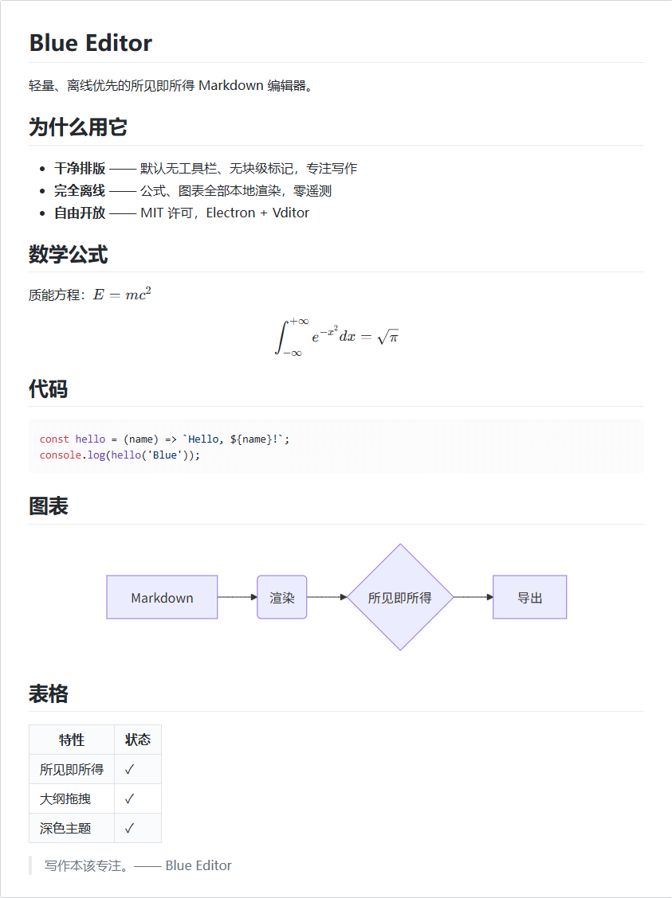
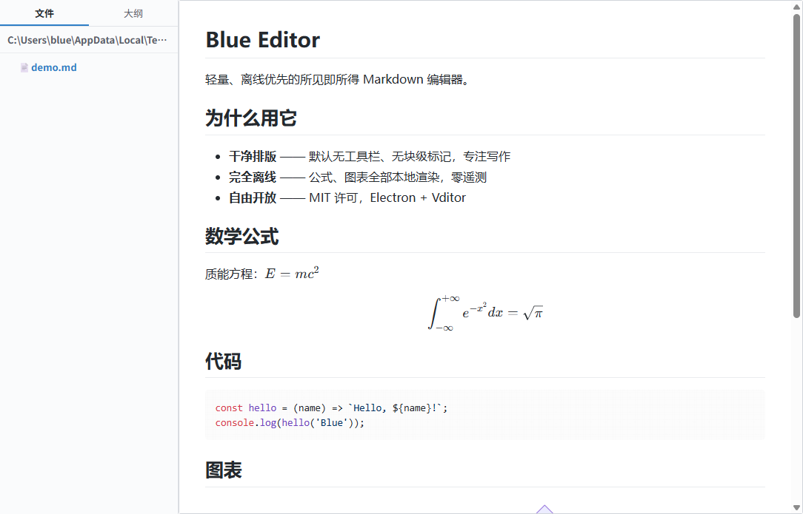
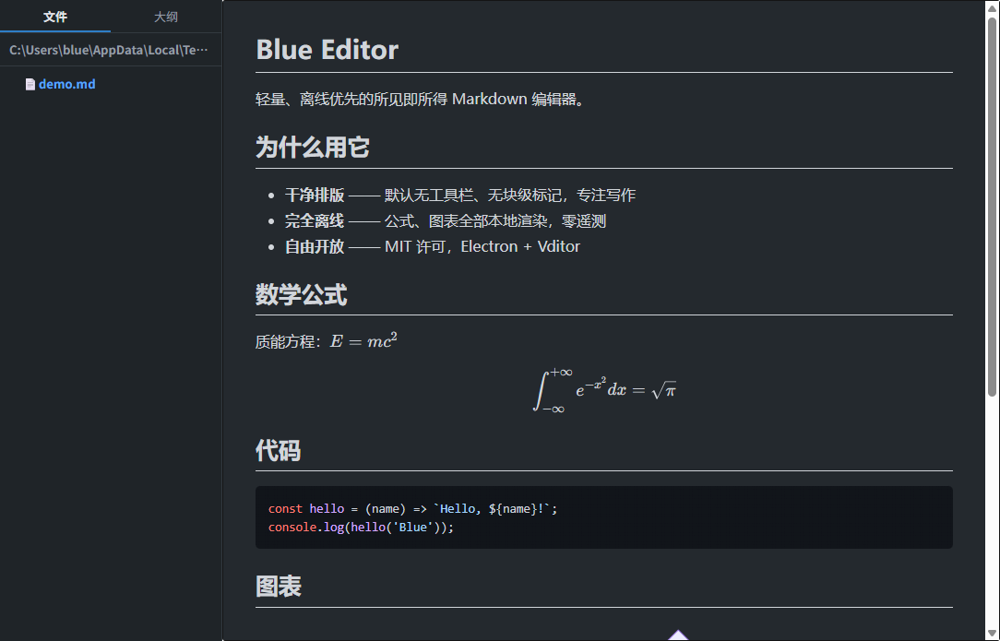

# Blue Editor

轻量、离线优先的所见即所得 Markdown 桌面编辑器。

> A lightweight, offline-first WYSIWYG Markdown editor — Electron + Vditor.
> No telemetry, no account, no auto-update phoning home.







## 功能

- **干净排版**：默认无工具栏、无块级标记（H1/</>/ToC 全部隐藏），
  视图菜单可唤回工具栏
- **所见即所得**编辑（Vditor wysiwyg），另有即时渲染 / 分屏预览两种模式
- **数学公式、图表**（KaTeX / mermaid / echarts / markmap / graphviz / abc 乐谱等，
  全部本地渲染，plantuml 等外发服务已被 CSP 拦掉）
- **左侧栏**
  - 文件树：就地展开、懒加载，当前文件高亮，右键新建/重命名/移回收站，
    拖拽移动（md 的 `.assets` 图片目录自动随迁）
  - 大纲：h1-h6 缩进树，点击跳转，**拖拽可整节重排文档**
  - 目录外部变更自动刷新
- **查找替换**（Ctrl+F）：匹配计数、上下跳转；查找期间自动收起侧栏，
  保证搜索范围只在正文
- **多窗口**：每个文档一个窗口（Ctrl+Shift+N），命令行再开文件进新窗
- **自动草稿**：1.5s 防抖，按文档路径存档，启动时逐窗恢复；
  关窗未保存给三选一（保存并关闭 / 不保存 / 取消）
- **外部修改检测**：文件被外部改动——干净文档自动重载，
  有未保存修改时横幅提示
- **图片**：粘贴落 `<文档名>.assets/`
- **导出**：PDF / HTML（公式图表完整渲染 + 样式全内联的单文件）/ PNG（全文长图）
- **Pandoc**（装了 ≥1.16 自动解锁）：导入 docx/epub/latex/org/rst 等，
  导出 docx/odt/epub/latex/rst
- **打印**（Ctrl+P）、深色主题

## 运行 / 构建

```bash
npm install
npm start                 # 开发模式
npx electron . file.md    # 打开指定文件
npm run dist              # 打包 → dist/（NSIS 安装包 + 绿色版，.md 关联随安装注册）
```

## 安全设计

- `nodeIntegration:false` + `contextIsolation:true`
- preload 按通道白名单暴露 IPC，没有通用 invoke
- 页面跳转 / 新窗口全部拦截：http(s) 链接一律交给系统浏览器
- CSP：`object-src 'none'; frame-src 'none'`——编辑器内不会加载任何
  远程对象（含 Vditor 默认会外发的 plantuml 渲染）

## 数据位置

`%APPDATA%/Blue Editor/`：`conf/conf.user.json`（设置）、`drafts/`（按文档的草稿）。

## 已知边界

- Windows 优先验证；macOS / Linux 未测
- 模式切换走 destroy+重建，撤销栈不保留
- "全部替换"是源文本级替换（代码块内也会命中）

## 开发备忘（踩过的坑）

1. **顶层标识符撞名**：渲染层顶层 `const`/`let` 与全局声明冲突即整脚本不执行
   → 整个 renderer.js 包 IIFE。
2. **`id="vditor"` 与 `window.vditor`**：named access 会解析成 DOM 元素
   → 调试句柄统一走 `window.__ed`。
3. **编辑器初始化是异步的**：`new Vditor` 返回 ≠ 就绪；所有写内容操作
   必须在 `after` 回调之后（渲染层有 `bootReady` + `editorReady` 双门闩）。
4. **截图纳入冒烟**：程序化断言（DOM 存在、getValue 正确）会漏纯视觉 bug——
   Vditor 4.x 样式表是 `dist/index.css`（3.x 叫 `index.min.css`），文件名
   404 时 DOM 一切正常却毫无样式。
5. `ELECTRON_RUN_AS_NODE=1` 会把 electron（含打包后的 exe）退化成纯 node，
   会把文件参数当 JS 执行 → 开发机有这个变量的话启动前先 `env -u` 掉。

## License

MIT © blue —— 第三方组件清单见 [THIRD_PARTY_NOTICES.md](THIRD_PARTY_NOTICES.md)。
