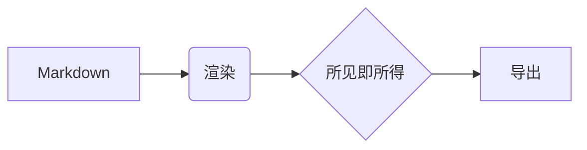

# Blue Editor

轻量、离线优先的所见即所得 Markdown 编辑器。

## 为什么用它

- **干净排版** —— 默认无工具栏、无块级标记，专注写作
- **完全离线** —— 公式、图表全部本地渲染，零遥测
- **自由开放** —— MIT 许可，Electron + Vditor

## 数学公式

质能方程：$E = mc^2$

$$\int_{-\infty}^{+\infty} e^{-x^2} dx = \sqrt{\pi}$$

## 代码

```js
const hello = (name) => `Hello, ${name}!`;
console.log(hello('Blue'));
```

## 图表



## 表格

| 特性 | 状态 |
| --- | --- |
| 所见即所得 | ✓ |
| 大纲拖拽 | ✓ |
| 深色主题 | ✓ |

> 写作本该专注。—— Blue Editor
